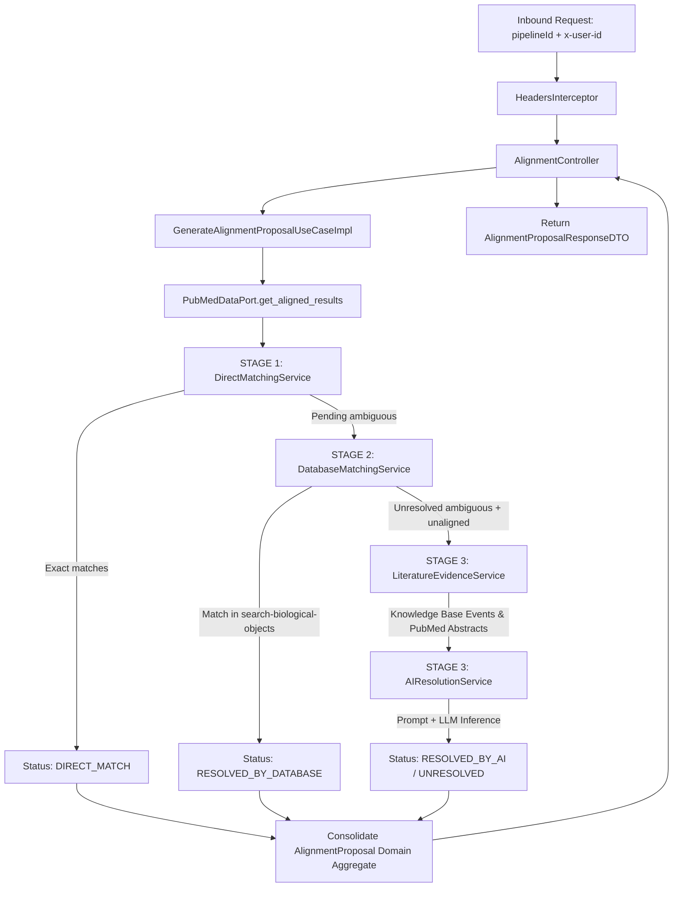

# Use Case Documentation: Generate Biological Entity Alignment Proposal

**Target Route**: `POST /ai-reasoning/alignments/v1/proposal/{pipelineId}`  
**Primary Interface**: [`GenerateAlignmentProposalUseCase`](../../src/application/use_cases/alignment_use_case.py)  
**Concrete Orchestrator**: [`GenerateAlignmentProposalUseCaseImpl`](../../src/application/use_cases/impl/alignment_use_case_impl.py)  
**Bounded Context Services**: [`src/application/services/alignment/`](../../src/application/services/alignment/)

---

## 1. Overview & Business Problem

During the automated scientific literature extraction pipeline in **BioPatternsG**, biomedical entities (genes, proteins, diseases, chemicals) are extracted from PubMed abstracts. Many terms cannot be immediately disambiguated because:
- **Historical abbreviations & non-canonical symbols**: E.g., `TATA` (referring to `TBP` - TATA-box binding protein).
- **Ambiguous symbols**: Terms with multiple candidate identifiers in external knowledge bases (`aligned_as`).
- **Completely unaligned entities**: Terms with zero direct matches in PubTator dictionaries (`no_aligned`).

The **Generate Alignment Proposal Use Case** receives preliminary pre-alignment data from `pubmed-integration`, evaluates them through a multi-stage deterministic and AI-powered resolution pipeline, and outputs an [`AlignmentProposal`](../../src/domain/models/alignment_proposal.py) aggregate root containing canonical symbols, status flags, and verifiable literature justifications for review in `biopatternsg-ui`.

---

## 2. Multi-Stage Architectural Pipeline

The orchestrator delegates complex domain logic to specialized single-responsibility services:



---

## 3. Detailed Stage Breakdown

### Stage 1: Deterministic Direct Matching (Zero LLM Tokens)
- **Class**: [`DirectMatchingService`](../../src/application/services/alignment/direct_matching_service.py)
- **Logic**:
  1. Entities already classified in `pre_data.aligned` are recognized immediately.
  2. For entities in `pre_data.aligned_as`, if the entity symbol exactly matches (case-insensitive) one of the candidate synonyms in `alternative_ids`, it is resolved without calling any external service or LLM.
- **Output Status**: `AlignmentStatus.DIRECT_MATCH`
- **PubMed IDs**: Empty list `[]`.
- **Reason**: Cites direct match in official synonyms.

---

### Stage 2: BiopatternsG Database Matching (Zero LLM Tokens)
- **Class**: [`DatabaseMatchingService`](../../src/application/services/alignment/database_matching_service.py)
- **Collaborator**: [`BiologicalObjectsPort`](../../src/domain/ports/biological_objects_port.py) (`GET /search-by-synonym/{synonym}` in `search-biological-objects`).
- **Logic**:
  1. For each ambiguous entity not resolved in Stage 1, queries `search_by_synonym` using `expert_object_name`.
  2. Inspects the first returned `BiologicalObjectDomain`.
  3. Checks if any synonym or official symbol of that database record matches any candidate in `alternative_ids`.
  4. If matched, resolves immediately and extracts HGNC and UniProt IDs.
- **Output Status**: `AlignmentStatus.RESOLVED_BY_DATABASE`
- **PubMed IDs**: Empty list `[]`.
- **Reason**: `Selected from BiopatternsG database (HGNC: <id>, UniProt: <id>)`.

---

### Stage 3: AI-Assisted Resolution with Literature Evidence (LLM)
- **Classes**:
  - [`LiteratureEvidenceService`](../../src/application/services/alignment/literature_evidence_service.py)
  - [`AIResolutionService`](../../src/application/services/alignment/ai_resolution_service.py)
- **Collaborators**:
  - [`PubMedDataPort`](../../src/domain/ports/pubmed_port.py) (`get_kb_events_by_term`, `get_publications_by_pmids`)
  - [`LLMReasoningPort`](../../src/domain/ports/llm_reasoning_port.py) (`generate_json`)
- **Logic**:
  1. **Literature Fetching**: For remaining unaligned and ambiguous entities, queries knowledge base interaction events (`first`, `relation`, `second`) and retrieves **all unique PubMed IDs without truncation**.
  2. **Abstract Retrieval**: Fetches full publication titles and abstract snippets for the collected PubMed IDs.
  3. **Micro-Prompt Construction**: Builds a structured prompt adhering to [`ALIGNMENT_SYSTEM_INSTRUCTION`](../../src/application/prompts/alignment_prompt.py).
  4. **Inference**: Queries the configured LLM provider (`gemini-3.5-flash-lite`, `deepseek-chat`, etc.) expecting structured JSON:
     ```json
     {
       "resolutions": [
         {
           "current": "TATA",
           "aligned": "TBP",
           "reason": "TATA-binding protein canonical mapping",
           "criterion": "canonical_gene_mapping",
           "pubmedIds": ["10523821"]
         }
       ]
     }
     ```
  5. **Mapping & Fallback**:
     - If resolved by AI: `AlignmentStatus.RESOLVED_BY_AI`, reason formatted as `Reason [Criterion: <criterion>]`, supporting `pubmed_ids` attached.
     - If LLM fails or fails to identify a canonical substitute: `AlignmentStatus.UNRESOLVED` (preserves original term or selects default candidate from alternatives safely).

---

## 4. Input & Output Contract

### Request
```http
POST /ai-reasoning/alignments/v1/proposal/{pipelineId} HTTP/1.1
Host: api.biopatternsg.com
x-user-id: 67123abcd890ef
Content-Type: application/json
```

### Response (`AlignmentProposalResponseDTO`)
```json
{
  "pipelineId": "pipeline-98213",
  "objects": [
    {
      "current": "SST",
      "aligned": "SST",
      "status": "DIRECT_MATCH",
      "reason": "Direct match in official PubTator synonyms",
      "pubmedIds": []
    },
    {
      "current": "AML1",
      "aligned": "RUNX1",
      "status": "RESOLVED_BY_DATABASE",
      "reason": "Selected from BiopatternsG database (HGNC: 10471, UniProt: Q01196)",
      "pubmedIds": []
    },
    {
      "current": "TATA",
      "aligned": "TBP",
      "status": "RESOLVED_BY_AI",
      "reason": "TATA-binding protein canonical mapping [Criterion: canonical_gene_mapping]",
      "pubmedIds": ["10523821"]
    }
  ]
}
```

---

## 5. Testing & Verification

Unit and integration tests for this use case:
- [`tests/unit/application/test_alignment_use_case.py`](../../tests/unit/application/test_alignment_use_case.py): End-to-end flow of the orchestrator with mocked ports.
- [`tests/unit/application/services/alignment/test_alignment_services.py`](../../tests/unit/application/services/alignment/test_alignment_services.py): Unit tests for each of the 4 specialized services.
- [`tests/integration/infrastructure/test_alignment_controller.py`](../../tests/integration/infrastructure/test_alignment_controller.py): Integration test covering endpoint status codes, DTO mapping, and `HeadersInterceptor` validation.
