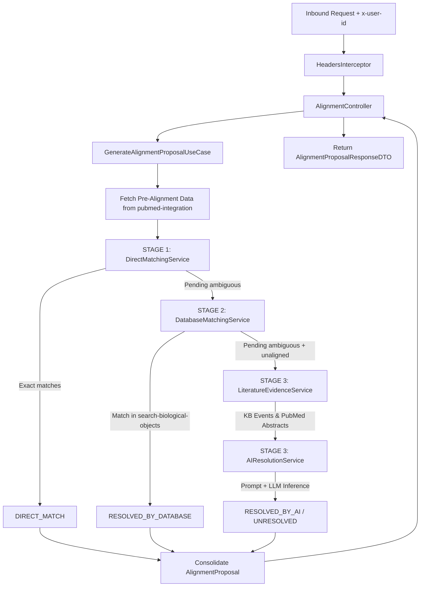

# AI Reasoning Service - Agent & Developer Documentation

Welcome to the **AI Reasoning Service** (`ai-reasoning-service`), a core microservice within the **BioPatternsG** platform. This service is dedicated to biomedical entity alignment, disambiguation, and AI-assisted reasoning across biological pipeline extractions.

This documentation is designed for both human developers and autonomous AI agents working on or integrating with this codebase.

---

## 1. High-Level Mission & Business Context

In the BioPatternsG ecosystem, scientific literature mining identifies genes, proteins, diseases, and chemical entities from PubMed publications. However:
- Some terms are extracted as non-standard acronyms, historical synonyms, or ambiguous abbreviations (e.g., `TATA`, `AML1`, `SOS`).
- Other terms are unaligned or have multiple competing biological identifiers.

The **AI Reasoning Service** resolves this ambiguity using a multi-stage deterministic and AI-powered pipeline to produce a canonically aligned proposal with scientific justifications and verifiable PubMed evidence.

---

## 2. Architectural Design (Hexagonal / Clean Architecture)

The codebase strictly adheres to **Hexagonal Architecture (Ports and Adapters)** and **Domain-Driven Design (DDD)** principles:

```
src/
├── domain/                      # 1. CORE DOMAIN (Zero external dependencies)
│   ├── models/                  # Domain entities & value objects
│   │   ├── entity.py            # AlignedItem, AlignmentStatus
│   │   ├── alignment_proposal.py# AlignmentProposal aggregate root
│   │   ├── pre_alignment.py     # PipelinePreAlignmentData, AmbiguousEntityItem
│   │   ├── biological_object.py # BiologicalObjectDomain
│   │   └── evidence.py          # KbEventDomain, PublicationEvidence
│   ├── ports/                   # Driven (outbound) interface contracts
│   │   ├── biological_objects_port.py
│   │   ├── llm_reasoning_port.py
│   │   └── pubmed_port.py
│   └── exceptions/              # Domain-specific business exceptions
│
├── application/                 # 2. APPLICATION LAYER (Use cases & Domain Services)
│   ├── use_cases/               # High-level orchestrators
│   │   ├── alignment_use_case.py       # Interface contract
│   │   └── impl/
│   │       └── alignment_use_case_impl.py  # Orchestrator (~100 LOC)
│   ├── services/                # Specialized domain services by bounded context
│   │   └── alignment/           # Bounded context: Alignment
│   │       ├── direct_matching_service.py     # STAGE 1: Deterministic matching (Zero LLM cost)
│   │       ├── database_matching_service.py   # STAGE 2: BiopatternsG KB database matching
│   │       ├── literature_evidence_service.py # PubMed interaction events & abstract fetching
│   │       └── ai_resolution_service.py       # STAGE 3: LLM reasoning, prompt generation, mapping
│   └── prompts/                 # Scientific system instructions & prompt builders
│       └── alignment_prompt.py  # Micro-prompt template with strict JSON response schema
│
└── infrastructure/              # 3. INFRASTRUCTURE LAYER (Technical implementations & drivers)
    ├── adapters/                # Outbound implementations of domain ports
    │   ├── biological_objects/  # HTTP adapter -> search-biological-objects service
    │   ├── pubmed/              # HTTP adapter -> pubmed-integration service
    │   └── llm/                 # LLM Adapter Factory (Gemini, DeepSeek, NVIDIA NIM, Ollama)
    ├── config/                  # Configuration & cross-cutting middleware
    │   ├── settings.py          # Pydantic Settings (.env management)
    │   └── interceptors/        # Request Interceptors
    │       └── headers_interceptor.py  # Enforces 'x-user-id' header on secured endpoints
    ├── delivery/                # Inbound delivery mechanisms
    │   └── rest/                # FastAPI Controllers & DTOs
    │       ├── controllers/     # alignment_controller.py, health_controller.py
    │       └── dtos/            # Pydantic DTOs for request/response serialization
    └── container.py             # Dependency Injection container wiring ports, services & use cases
```

---

## 3. The 3-Stage Alignment Pipeline Workflow

When a request is received at `POST /ai-reasoning/alignments/v1/proposal/{pipelineId}`:



### Stage 1: Deterministic Direct Matching (`DirectMatchingService`)
- Evaluates entities already classified in `aligned`.
- Evaluates entities in `aligned_as` whose symbol exactly matches one of the candidate synonyms (case-insensitive).
- **Cost**: 0 LLM tokens, instantaneous.
- **Status**: `DIRECT_MATCH`.

### Stage 2: Database Matching (`DatabaseMatchingService`)
- Queries `search-biological-objects` via `GET /search-by-synonym/{synonym}`.
- If the first biological object has synonyms or official symbols matching any candidate in `alternative_ids`:
  - Resolves immediately citing the BiopatternsG database with HGNC and UniProt identifiers.
- **Cost**: 0 LLM tokens.
- **Status**: `RESOLVED_BY_DATABASE`.

### Stage 3: AI-Assisted Resolution with Literature Evidence (`LiteratureEvidenceService` & `AIResolutionService`)
- Collects interaction events and abstracts from PubMed for unresolved terms without ID truncation.
- Builds a scientific micro-prompt citing literature context.
- Invokes the configured LLM provider (`gemini`, `deepseek`, `nvidia`, `ollama`) expecting structured JSON output.
- Formats justification with scientific criterion (e.g. `[Criterion: canonical_gene_mapping]`).
- **Status**: `RESOLVED_BY_AI` or `UNRESOLVED` (safe fallback preserving original term if unresolvable).

---

## 4. Key Endpoints

| Method | Path | Secured? | Description |
|---|---|---|---|
| `GET` | `/ai-reasoning/health` | No | Liveness/readiness health check returning status and active `llm_provider`. |
| `GET` | `/ai-reasoning/docs` | No | Swagger / OpenAPI UI. |
| `POST` | `/ai-reasoning/alignments/v1/proposal/{pipelineId}` | **Yes (`x-user-id`)** | Generates the consolidated biological alignment proposal for a pipeline. |

---

## 5. Security & Inbound Headers (`HeadersInterceptor`)

All secured endpoints pass through [`HeadersInterceptor`](file:///home/yacson/Proyectos/biopatternsg-ms/services/ai-reasoning-service/src/infrastructure/config/interceptors/headers_interceptor.py):
- **Requirement**: The `x-user-id` header must be present and non-empty.
- **Failure**: Returns HTTP `400 Bad Request` with `{"detail": "Header 'x-user-id' is required."}`.
- **Downstream propagation**: The interceptor sets `request.state.user_id = user_id.strip()`, and controllers forward it to upstream microservices (`pubmed-integration`, `search-biological-objects`).
- **Exempt paths**: `/ai-reasoning/health`, `/`, `/ai-reasoning/docs`, `/ai-reasoning/openapi.json`, and CORS `OPTIONS` preflights.

---

## 6. Environment Variables & Configuration

Handled through Pydantic Settings in [`src/infrastructure/config/settings.py`](file:///home/yacson/Proyectos/biopatternsg-ms/services/ai-reasoning-service/src/infrastructure/config/settings.py):

| Variable | Default Value | Description |
|---|---|---|
| `APP_PORT` | `8000` (Docker internal) / `8009` (Host) | Port where FastAPI listens. |
| `PUBMED_INTEGRATION_URL` | `http://pubmed-integration:8080` | URL of the `pubmed-integration` Quarkus service. |
| `BIOLOGICAL_OBJECTS_URL` | `http://search-biological-objects:8080` | URL of the `search-biological-objects` Quarkus service. |
| `LLM_PROVIDER` | `gemini` | Active provider: `gemini`, `deepseek`, `nvidia`, or `ollama`. |
| `LLM_MODEL_NAME` | `gemini-3.5-flash-lite` | Model identifier used for inference. |
| `GEMINI_API_KEY` | *(Secret)* | API key for Google Gemini (v1beta API). |
| `DEEPSEEK_API_KEY` | *(Secret)* | API key for DeepSeek API. |
| `NVIDIA_API_KEY` | *(Secret)* | API key for NVIDIA NIM API. |
| `OLLAMA_API_URL` | `http://localhost:11434` | URL for local Ollama instances. |

---

## 7. CI/CD & Deployment Guide (Jenkins)

The pipeline is defined in [`jenkins/Jenkinsfile`](file:///home/yacson/Proyectos/biopatternsg-ms/services/ai-reasoning-service/jenkins/Jenkinsfile):
- **Agent**: `agent any`.
- **Secret Management**: Retrieves `GEMINI_API_KEY` from Jenkins Credentials store (`Secret text`) via `withCredentials`.
- **Network**: Deploys into `general-network`.
- **Host Port**: Default mapped to **`8009:8000`** to avoid port collisions with other services.

---

## 8. Development & Testing Commands

To run tests locally:
```bash
# Inside services/ai-reasoning-service
PYTHONPATH=. ./venv/bin/pytest tests/ -v
```

To run tests with Docker:
```bash
docker build -t ai-reasoning-service:test .
docker run --rm -v "$PWD/tests:/app/tests:ro" --entrypoint pytest ai-reasoning-service:test tests/ -v -p no:cacheprovider
```

---

## 9. Conventions for Future Agent Contributions
1. **Never put business logic in controllers or ports**: Keep delivery mechanisms thin.
2. **Follow SRP in `src/application/services/`**: If a new resolution strategy or algorithm is added, encapsulate it in a dedicated service class inside `src/application/services/<context>/`.
3. **Keep `use_case_impl.py` as an orchestrator**: The use case should only coordinate services, not execute low-level parsing or API requests directly.
4. **Preserve backward compatibility**: Ensure all 16 existing tests pass before pushing any modifications.
